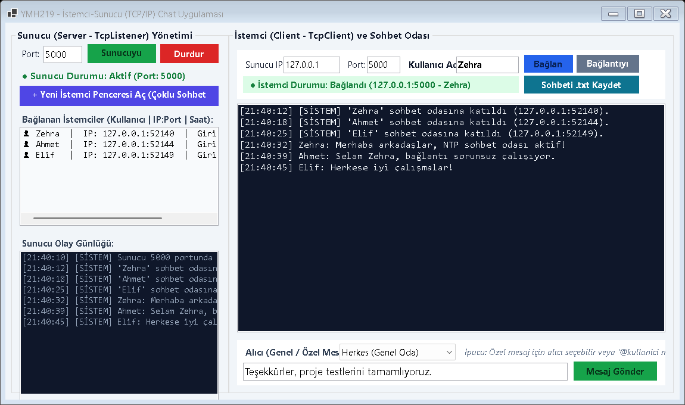
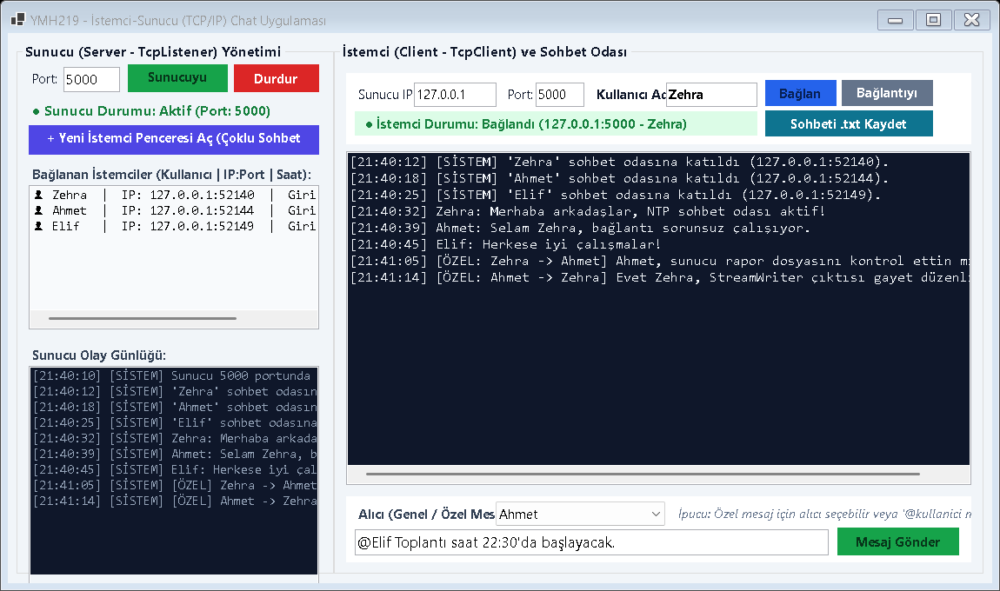

# YMH219-ChatApp — İstemci-Sunucu (TCP/IP) Sohbet Uygulaması

**Nesne Tabanlı Programlama (YMH 219)** dersi 3. uygulama ödevi kapsamında geliştirilmiş, C# ve Windows Forms tabanlı **asenkron İstemci-Sunucu (Client-Server) Sohbet Sistemi**dir. Proje; `TcpListener`, `TcpClient`, `NetworkStream`, `StreamReader`/`StreamWriter` ve `async/await` mimarisini kullanarak aynı bilgisayarda (`127.0.0.1`) veya yerel ağda (`LAN`) gerçek zamanlı mesajlaşma sağlar.

---

## Kullanılan Teknoloji ve Kütüphaneler

* **Dil:** C#
* **Platform / Çerçeve:** .NET (`Windows Forms`)
* **Ağ İletişimi:** `System.Net.Sockets` (`TcpListener`, `TcpClient`, `NetworkStream`)
* **Asenkron Programlama:** `System.Threading.Tasks` (`async/await`, `CancellationTokenSource`)
* **Akış ve Dosya Yönetimi:** `System.IO` (`StreamReader`, `StreamWriter`)
* **Harici NuGet Paketi:** Yok

---

## Sınıf ve Mimari Yapı (OOP Tasarımı)

* **`Models/ChatMessageType.cs`:** Ağ paketlerinin türünü (`System`, `Public`, `Private`, `ClientListUpdate`) belirleyen numaralandırma (`enum`).
* **`Models/ChatMessage.cs`:** Gönderen (`Sender`), alıcı (`Recipient`), içerik (`Content`), zaman damgası (`Timestamp`) ve TCP akışı üzerinde serileştirme (`ToWireString` / `FromWireString`) metotlarını barındıran OOP sınıfı.
* **`Models/ConnectedClientInfo.cs`:** Sunucuya bağlı her istemcinin kullanıcı adını, `IP:Port` bilgisini ve bağlanma saatini kapsüller.
* **`Services/ChatServer.cs`:** `TcpListener` ile gelen bağlantıları asenkron kabul eden, bağlı istemcileri `ConcurrentDictionary` içinde yöneten, genel oda yayını (`BroadcastMessageAsync`) ve özel mesaj yönlendirmesi (`RoutePrivateMessageAsync`) yapan sunucu sınıfı.
* **`Services/ChatClient.cs`:** `TcpClient` ile sunucuya bağlanan, arka planda arayüzü dondurmadan mesaj dinleyen (`ReceiveLoopAsync`) ve sohbet geçmişini `.txt` dosyasına kaydeden istemci sınıfı.
* **`Forms/MainForm.cs`:** Hem Sunucu yönetim panelini hem de İstemci sohbet arayüzünü sunan, ayrıca tek tıkla yeni istemci pencereleri açabilen ana form.

---

## Kurulum ve Çalıştırma Adımları

1. Depoyu bilgisayarınıza klonlayın:
   ```bash
   git clone https://github.com/duyareminezehra/YMH219-ChatApp.git
   cd YMH219-ChatApp
   ```
2. `YMH219-ChatApp.sln` dosyasını **Visual Studio** ile açıp **F5** tuşuna basın veya terminalden çalıştırın:
   ```bash
   dotnet build
   dotnet run
   ```
3. **Aynı Bilgisayarda Çoklu İstemci Testi:**
   * Sol panelden **Sunucuyu Başlat** butonuna tıklayın (varsayılan port: `5000`).
   * Sağ panelden kullanıcı adınızı girip **Bağlan** butonuna basın.
   * Sol paneldeki **"+ Yeni İstemci Penceresi Aç"** butonuna tıklayarak ikinci/üçüncü istemci pencerelerini açın ve onları da **Bağlan** butonuyla odaya dahil edin.

---

## Uygulamanın Temel Özellikleri

* **Asgari Gereksinimler:**
  * Aynı bilgisayarda (`127.0.0.1`) veya yerel ağda çalışan `TcpListener` sunucu ve `TcpClient` istemci mimarisi.
  * Kullanıcı adı ile bağlanma, **Bağlan**, **Mesaj Gönder** ve **Bağlantıyı Kes** kontrolleri.
  * Gönderilen ve alınan tüm mesajların zaman damgasıyla (`[HH:mm:ss]`) listelenmesi.
  * Sunucu tarafında bağlanan istemcilerin kullanıcı adı, `IP:Port` ve giriş saatiyle anlık listelenmesi.
  * Bağlantı kopması veya erişilemeyen sunucu hatalarının uygulamayı kapatmadan kullanıcıya bildirilmesi.
* **Eklenen İsteğe Bağlı (Bonus) Özellikler:**
  * **Çoklu İstemci Sohbet Odası:** Birden fazla istemci aynı anda sunucuya bağlanıp grup sohbeti yapabilir.
  * **Özel Mesajlaşma (DM):** Alıcı açılır listesinden belirli bir kullanıcı seçilerek veya mesaj kutusuna `@kullanici mesaj` yazılarak yalnızca hedef kişiye özel mesaj gönderilebilir.
  * **Sohbet Geçmişini Kaydetme:** **Sohbeti .txt Kaydet** butonu ile tüm mesaj geçmişi dosyaya aktarılabilir.

---

## Ekran Görüntüleri

### 1. Sunucu Yönetimi, Bağlı İstemciler ve Genel Oda Sohbeti


### 2. Kullanıcılar Arası Özel Mesajlaşma (DM) Görünümü


---

## Bilinen Sınırlamalar ve Geliştirme Notları

* Aynı kullanıcı adıyla birden fazla istemci bağlanmak isterse sunucu çakışmayı önlemek için ikinci kullanıcı adına otomatik sonek (`Kullanici_2`) atar.
* Yerel ağdaki (LAN) farklı bilgisayarlar arasında bağlantı kurarken Windows Güvenlik Duvarı'nda seçilen TCP portuna (örn. `5000`) izin verilmesi gerekebilir.

---

## Öğrenci Bilgileri

* **Adı Soyadı:** Emine Zehra Duyar
* **Öğrenci Numarası:** 250541027
* **Ders:** YMH 219 — Nesne Tabanlı Programlama
